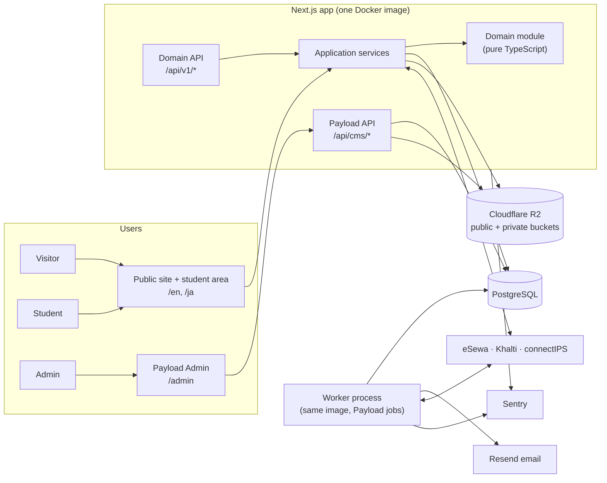
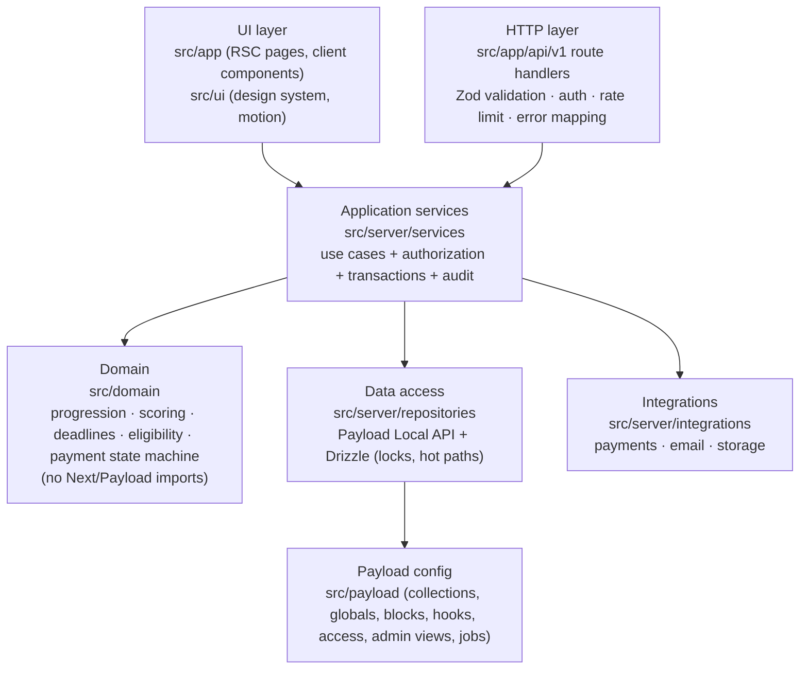
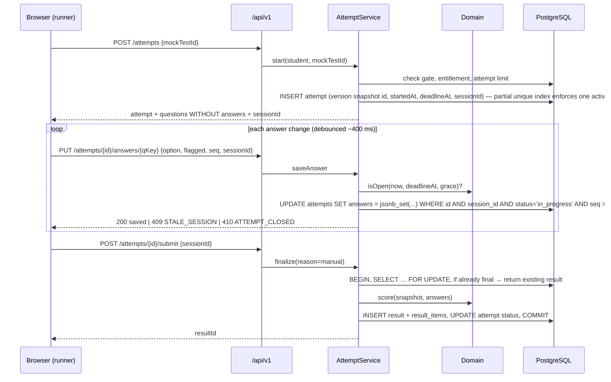
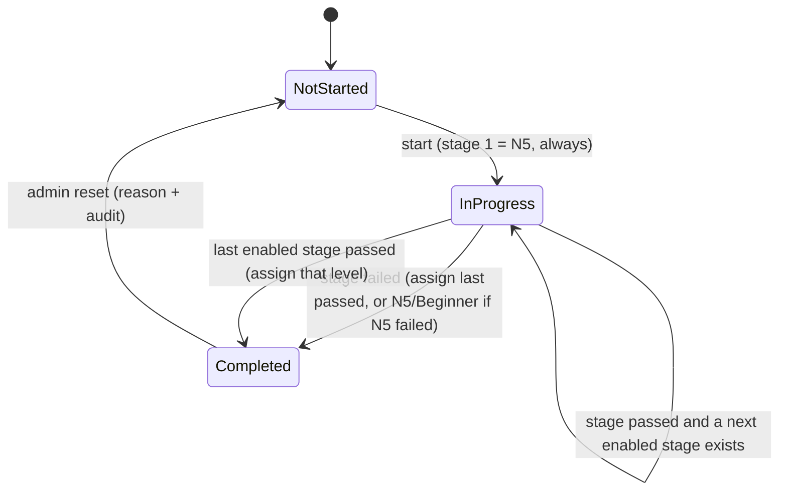

# Architecture — Nihongo Mock

**Status:** Phase 4 baseline, 2026-10-14. Built on the approved stack D-025, D-033..D-045. Items marked *(technical default)* are engineering choices inside the approved stack. The owner may override them.

---

## 1. System context



**Processes:** (1) `web`: the Next.js server, which serves the site, student area, domain API, Payload admin and Payload API; it can run as several identical instances behind a load balancer. (2) `worker`: the same image started with the Payload `jobs:run` command; it runs emails, deadline sweeps, payment reconciliation and scheduled publishing. Exactly **one** worker runs, so jobs never run twice. (3) PostgreSQL. (4) R2 object storage. The web process stays stateless, so it can scale horizontally (D-032).

## 2. Layers and module boundaries



Rules:
1. **`src/domain` is pure.** No imports from Next.js, Payload, Drizzle or Node I/O. All exam rules live here: N5-first progression, threshold comparison, scoring, section minimums, deadline/grace calculation, eligibility, payment state transitions. Unit tested to 100% of branches.
2. **Every state change goes through an application service.** UI code, route handlers and Payload hooks call services; they never write domain tables directly. Services perform authorization (TSR-01), open transactions, call the domain, persist, and write audit events.
3. **Reads for pages** call services or read-model functions from Server Components (no client-side fetch for initial render).
4. **Payload owns content and configuration.** Exam-critical writes (attempt answers, finalization, orders, payment events) use Drizzle inside explicit transactions for row locks and idempotency.
5. **Integrations are adapters** behind interfaces (`PaymentProvider`, `Mailer`, `ObjectStore`), so they can be swapped and faked in tests.

## 3. Routing

| Path | Served by | Notes |
|---|---|---|
| `/` | redirect | To `/en`, or to `/ja` if the `NEXT_LOCALE` cookie says so (D-028). No Accept-Language detection. |
| `/en/*`, `/ja/*` | `src/app/(frontend)/[locale]` | Public pages (CMS page builder) and student area under `/[locale]/app/*` |
| `/admin/*` | Payload admin | Admins only; Payload's own login |
| `/api/cms/*` | Payload REST | Payload `routes.api = "/api/cms"` *(technical default)*. Collection access rules deny everything students don't need. |
| `/api/v1/*` | Domain API route handlers | JSON; versioned; mobile-ready (D-025). See `docs/API_DOCUMENTATION.md`. |
| `/api/v1/payments/{provider}/callback` | Payment callbacks | Server-to-server or browser-return endpoints; never trusted without verification |
| `/healthz`, `/readyz` | route handlers | Liveness / readiness (database reachable, migrations current) |

The Next.js proxy (`proxy.ts`, formerly middleware) handles: locale prefix enforcement (excluding `/admin`, `/api`), request ID, security headers, and redirecting unauthenticated users away from `/[locale]/app/*` (UX only; the server enforces it again).

## 4. Authentication and authorization

- **Collections:** `admins` (Payload admin users) and `students` (site users). Both are Payload auth collections with `useSessions` (revocable sessions; Payload default), `maxLoginAttempts`/`lockTime`, and HTTP-only, `Secure`, `SameSite=Lax` cookies. Students have `verify: true` (D-021).
- **Student login/sign-up/reset** go through `/api/v1/auth/*`, which wraps Payload's auth operations for the `students` collection. That adds rate limiting, non-enumerating responses, locale-aware emails and audit events.
- **Rate limiting** *(technical default)*: a PostgreSQL-backed fixed-window counter (`rate_limits` table), keyed by IP + identifier for login, sign-up, reset and contact; a per-attempt limit on answer saves. No Redis.
- **Admin MFA:** TOTP addition, if OPS-2b requires it (Phase 7).
- **Authorization model:** permissions are strings (e.g. `questions.publish`, `students.override_level`, `orders.read`). Roles bundle permissions and are editable by a Super Admin (D-022). Payload `access` functions and service-level checks both call one shared `can(user, permission, resource?)` helper. Students have **no** Payload admin access; their access is ownership-based (`resource.studentId === session.studentId`).
- **Level gate (LD-R02):** one service guard, `requireDeterminedLevel(student)`, is called by every materials, mock-test and results service and route. UI redirects are only a convenience.
- **One browser, one session:** Payload uses one auth cookie per browser. An admin who also tests as a student uses a separate browser profile. This is documented for admins.

## 5. Core runtime flows

### 5.1 Starting and running an attempt (mock test or determination stage)



- **Deadline:** `deadlineAt = startedAt + duration` comes from the version snapshot. The browser timer only displays it (it syncs to the server time sent with each response). Saves are accepted until `deadlineAt + grace`. *Technical default:* grace = 3 s, a system setting with bounds 0–10 s, to absorb network latency.
- **Expiry:** any request touching an expired, unfinalized attempt finalizes it first (lazy). The worker's `sweep-expired-attempts` job runs every minute as a backup. Both use the same idempotent `finalize` (`submitReason = timeout`).
- **Resume / latest tab wins (D-027):** opening the runner calls `POST /attempts/{id}/resume`, which rotates `sessionId`. Saves from the old tab get `409 STALE_SESSION`, and that tab shows the "Session moved" screen.
- **Offline:** the runner keeps unsent changes in memory and `sessionStorage` and retries with backoff. A banner shows "Not saved — retrying". Nothing is accepted after the deadline.

### 5.2 Level determination (D-008..D-013)



- One `determination_sessions` row per run binds the **published determination config version**. Admin edits made later don't affect a running session.
- Each stage is an `attempt` with `kind = determination`, using the same runner and finalize path.
- After a stage is finalized, the service calls the domain `nextStep(configSnapshot, stageResults)` → `{ next: stageIndex } | { done: assignedLevel }`, inside the same transaction. On `done`: write `level_assignments` (append-only), update the student's `determinationStatus` and `assignedLevel`, and write an audit event.
- An admin override writes a `level_assignments` row with `source = override`, a reason and the actor (Super Admin only).

### 5.3 Publishing content and tests

- Payload drafts and versions are used for pages, materials, questions and mock tests.
- **Mock test publish** → `afterChange` hook calls `MockTestService.createVersion()`: it validates (answers present, section mappings, levels, marks, media) and writes an **immutable `mock_test_versions` row** whose snapshot contains every question, option, correct key, explanation (EN/JA), marks and config. Attempts reference the version. Later edits never change past attempts (RS-R06).
- Determination config publish → same pattern (`determination_config_versions`).
- Publishing any public content calls `revalidateTag(...)`, so cached pages update immediately without deployment (PRD-05).

### 5.4 Purchase and payment (detailed in Phases 19–23)

`POST /api/v1/orders` (server prices from `products`) → `POST /api/v1/orders/{id}/pay {provider}` → provider redirect → `/api/v1/payments/{provider}/callback` → **server-side verification with the provider** → order state machine (domain) → entitlement created in the same transaction. Duplicate callbacks are deduplicated by a unique `(provider, dedupe_key)`. The worker's `reconcile-payments` job re-checks pending or uncertain orders. A return URL only moves the browser to a status page that polls the server.

## 6. Internationalisation

- next-intl with `localePrefix: "always"` (`/en`, `/ja`), default `en`, **locale detection off** (D-028); the toggle sets the `NEXT_LOCALE` cookie and, when logged in, `students.preferredLocale`.
- **Content:** Payload `localization: { locales: ["en", "ja"], defaultLocale: "en", fallback: true }`.
- **UI labels:** code catalogues `src/i18n/messages/{en,ja}.json` (complete defaults), merged at request time with the CMS `ui-labels` global, cached and revalidated on change (D-030).
- Japanese **learning content** (question stems, options) is not localized; explanations and instructions are.

## 7. Media

Two upload collections *(technical default)*: `site-media` → **public** bucket/prefix behind a CDN (marketing images, logos, parallax layers); `learning-media` → **private** bucket (material audio/PDFs, question media), served through short-lived signed URLs issued after a service-level access check (TSR-07). Uploads are validated by MIME type, extension, magic bytes and size (audio ≤ 50 MB, PDF ≤ 25 MB, image ≤ 10 MB *(technical defaults, CMS setting)*). SVG uploads are sanitised or limited to admins with `media.upload_svg`.

## 8. Caching and performance

- Public pages: rendered with Next.js `use cache` and tagged by CMS document (`page:{id}`, `nav`, `labels:{locale}`, `theme`); Payload `afterChange` hooks call `revalidateTag`.
- Student pages and the runner are dynamic and uncached. Questions for an attempt come from the version snapshot (one row read).
- Database: pooled connections (max per instance from env); indexes per `docs/DATABASE_ARCHITECTURE.md`; no N+1 reads in list pages (Payload `depth` controlled).
- Motion: GSAP is code-split and loaded only on routes with scroll presets.
- Target: the 500-concurrent load test (D-032) in Phase 26.

## 9. Errors, logging, audit

- **Error model:** see `docs/API_DOCUMENTATION.md` §3. Domain errors are typed (`DomainError` with a stable `code`); unknown errors map to `INTERNAL` with no internal detail exposed.
- **Logging:** pino JSON logs with `requestId`, user ID (never email), route and duration. Passwords, tokens, keys and payment payload secrets are redacted.
- **Audit (`audit_events`, append-only):** admin logins/failures, role and permission changes, determination reset/override, config publishes (determination, mock tests, theme), question publish/archive, import commits, product/price changes, order and payment state transitions, entitlement grants, result views by admins (RS-R07). Written by services and Payload hooks with actor, action, entity, before/after (redacted), IP and request ID.
- **Sentry** for web and worker; environment tags; PII scrubbing on.

### 9a. Admin module checklist (Phase 9, D-068)

Every new admin collection or global:
1. `admin.group` from `ADMIN_GROUPS` (`src/payload/admin/groups.ts`); EN/JA labels and descriptions.
2. List settings: `defaultColumns`, `listSearchableFields`, `pagination`, `defaultSort`.
3. Access with `hasPermission(...)`; no `delete` where history depends on the record.
4. `auditTrail({ entityType, action, summary })` hooks (`src/payload/hooks/auditTrail.ts`).
5. Rules that involve other records as field validators (messages via `say(req, en, ja)`), never thrown from hooks.
6. Integration tests for CRUD, validation, pagination, access denial and audit; an admin E2E for the main flow.

## 10. Configuration

- Environment variables are validated at startup with Zod (`src/server/env.ts`); the process exits with a clear message if any are missing (TSR-10). Names are listed in `docs/ENVIRONMENT_REQUIREMENTS.md` (finalized in Phase 6).
- Business configuration lives in the CMS (D-030); secrets never do (D-020).
- Environments: `local` (Docker Compose Postgres, R2 or a local S3-compatible store, email to console), `test` (CI Postgres service, fakes for providers), `staging` (sandbox payment credentials), `production`.

## 11. Repository structure (single Next.js app)

```
/
├─ src/
│  ├─ app/
│  │  ├─ (frontend)/[locale]/           public pages, auth pages, app/* student area
│  │  ├─ (payload)/admin/               Payload admin (generated)
│  │  ├─ (payload)/api/cms/[...slug]/   Payload REST (generated)
│  │  └─ api/v1/                        domain API route handlers
│  ├─ payload/
│  │  ├─ collections/  globals/  blocks/  fields/  access/  hooks/
│  │  ├─ admin/        custom admin views (test builder, import, determination config)
│  │  └─ jobs/         task definitions
│  ├─ payload.config.ts
│  ├─ domain/          determination/ scoring/ attempts/ eligibility/ commerce/ payments/
│  ├─ server/
│  │  ├─ services/  repositories/  auth/  http/ (errors, validation, rate-limit)
│  │  ├─ integrations/ payments/{esewa,khalti,connectips}/  email/  storage/
│  │  ├─ audit/  env.ts  logger.ts
│  ├─ ui/              components/  motion/  tokens/  route-map/
│  ├─ i18n/            routing.ts  request.ts  messages/{en,ja}.json
│  └─ proxy.ts
├─ tests/   unit/  integration/  e2e/  load/
├─ docker/  Dockerfile  compose.dev.yml
├─ docs/
└─ .github/workflows/ci.yml
```

## 12. Remaining architectural blockers

None block Phase 5. Items to settle later: hosting provider (TECH-5, before staging); admin MFA (OPS-2b, Phase 7); payment-provider specifics (Phases 20–23); the Payload version line (3.x vs 4.0 GA) at Phase 6 (RISK-08).
