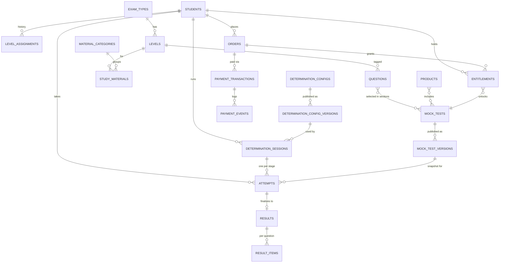

# Database Architecture — Nihongo Mock

**Status:** PROPOSED — **owner approval required before any migration is applied** (playbook §11.6). PostgreSQL via Payload's Drizzle-based adapter (D-034). Last updated 2026-10-14 (Phase 5).

How to read this: **[P]** = Payload collection (Payload creates its tables, admin screens, localized `_locales` tables and, if versioned, `_v` tables). **[P-ro]** = Payload collection that is read-only in the admin (written only by services). **[G]** = Payload global (a single settings document). **[T]** = custom table added through the adapter's `beforeSchemaInit` hook (not shown in the admin). Constraints Payload cannot express (partial unique indexes, CHECKs) are added in migrations with raw SQL.

---

## 1. Design principles

1. **History never changes.** An attempt binds to an immutable **version snapshot** of its test or determination config. Results store their own totals, and per-question review rows reference the snapshot. Editing or archiving a question, test, explanation or price later never alters a past result or order (RS-R06, TSR-05).
2. **Hot paths are narrow.** Answer autosave updates one JSONB column on one attempt row. Finalization writes once, in a transaction with `SELECT … FOR UPDATE`.
3. **Constraints do the guarding.** Partial unique indexes enforce one active attempt per test (D-027), one running determination per student, and no duplicate payment events or entitlements. Business rules are also checked in the domain layer, but the database is the last line of defence against races.
4. **Archive, don't delete.** Content uses `status`/`archivedAt`. Financial, audit, attempt and result rows have no delete permission for any role (TSR-09).
5. **Money in integer paisa** (`bigint`), currency `NPR`. Percentages as `numeric(5,2)`, computed by the domain with the agreed comparison rule (D-009: no rounding before comparing).
6. **Bilingual fields** use Payload localization (`en`, `ja`, fallback `en`). Japanese learning content (stems, options) is not localized.
7. **All timestamps** are `timestamptz` (UTC); display in Asia/Kathmandu.

## 2. Entity-relationship overview



## 3. Entities

### 3.1 Identity and access

| Entity | Type | Key fields | Constraints / notes |
|---|---|---|---|
| `admins` | [P] auth (admin panel user) | email, name, roles → `roles`[], status (`active`/`disabled`), lastLoginAt, mfa fields (if OPS-2b) | unique email (citext); sessions on; lockout |
| `roles` | [P] | name, description, permissions (multi-select of permission keys), isSystem | `Super Admin` is system-locked: it cannot be deleted or lose `roles.manage` |
| `students` *(assignedLevel/assignedAt added Phase 10; FK RESTRICT)* | [P] auth, `verify: true` | email, name, preferredLocale (`en`/`ja`), status (`active`/`suspended`), **determinationStatus** (`not_started`/`in_progress`/`completed`), **assignedLevel** → `levels`, assignedAt | unique email (citext). `determinationStatus` and `assignedLevel` are changed **only** by services (field-level access denies admin edits; overrides go through the audited action). |
| `rate_limits` | [T] | key, windowStart, count | PK (key, windowStart); pruned by a job |
| `audit_events` | [P-ro] | at, actorType (`admin`/`student`/`system`), actorId, action, entityType, entityId, summary, before jsonb, after jsonb (redacted), ip, userAgent, requestId | no update/delete access; index (entityType, entityId, at), (actorId, at), (action, at) |

### 3.2 Catalogue

| Entity | Type | Key fields | Constraints / notes |
|---|---|---|---|
| `exam_types` *(implemented Phase 9; Phase 13: sections are a separate table, D-103 — `defaultSections[]` below is superseded)* | [P] localized | code (`JLPT`/`NAT`/`JFT`), name, description, order, enabled, defaultSections[] {key, name, order}, nonAffiliationNotice | unique code |
| `exam_sections` *(implemented Phase 13, D-103)* | [P] localized | examType → `exam_types` (RESTRICT, fixed after creation), key, name, description, order, levels → `levels`[] (empty = all levels of the exam), enabled | unique (examType, key); never deleted; seeded from the official guides
| `levels` *(implemented Phase 9; colours `lineColor`/`badgeColor` hex; FKs RESTRICT delete)* | [P] localized | examType → `exam_types`, code (`N5`, `5Q`, `A2.1`…), name, order (easiest = 1), equivalentJlpt → `levels` (NAT mapping, D-014), lineColor, badgeColor, **enabledForMockTests**, **enabledForDetermination**, **enabledForStudy** | unique (examType, code). The three flags implement D-008 and SM-R02: seed JLPT N5–N3 enabled for determination and study; JLPT N5–N1, NAT 5Q–1Q and JFT tiers enabled for mock tests. A level is shown publicly only if it is enabled **and** has published content. |

### 3.3 Study materials and media

| Entity | Type | Key fields | Constraints / notes |
|---|---|---|---|
| `material_categories` *(implemented Phase 12)* | [P] localized | key (immutable), name, symbol (e.g. 聴), order, enabled | seeded in the migration as SQL: kanji 漢, grammar 文, reading 読, listening 聴; never deleted |
| `study_materials` *(implemented Phase 12; `archived` flag; attachments are an array of {media, title, allowDownload (12b, default false)}; deletable with `materials.delete`, versions go too)* | [P] localized, drafts + versions | title, slug, level → `levels`, category, summary, body (Lexical + ruby), attachments → `learning_media`[], order | unique (slug); index (level, category, status); student queries filter `enabledForStudy` and level ≤ assigned |
| `site_media` | [P] upload, **public** | alt (localized), kind, mime, size, width/height | marketing images, logos, parallax layers |
| `learning_media` *(implemented Phase 12; local disk until R2, D-088; 12b: `archived` flag, deletable only when unused — D-092)* | [P] upload, **private** | alt/caption (localized), kind (`audio`/`pdf`/`image`, set by the server), mime, size, durationSec | served only through signed URLs (D-087); type/size/content checked on upload (D-086); never deleted |
| `study_progress` *(implemented Phase 13b, D-107)* | [P-ro] | student → `students` (CASCADE), material → `study_materials` (CASCADE), firstOpenedAt, lastOpenedAt, studiedAt | unique (student, material); written only by the study service (upserts); no time-on-page data

### 3.4 Question bank

| Entity | Type | Key fields | Constraints / notes |
|---|---|---|---|
| `questions` *(core implemented Phase 11: no media/sections/topics/difficulty/hash yet, plain-text stem with furigana markup, `archived` flag)* | [P] drafts + versions | **key** (stable public ID, e.g. `Q-000123`), examType, level, sectionKey, topics[], difficulty (1–5), stem (Lexical, JA, ruby), stemMedia → `learning_media`, options[] {**key** `A`–`D`, content, media}, **correctOptionKey**, explanation (localized Lexical), marks (default 1), source/provenance, **rightsConfirmed** (must be true to publish, CON-2), normalizedStemHash | unique key; validation hook: exactly one correct key that exists among the options, 2–6 options, media present; index (examType, level, sectionKey, status); index on normalizedStemHash for duplicate detection (CON-4) |
| `import_batches` | [P-ro] | file → `learning_media`, templateVersion, status (`validated`/`committed`/`failed`), counts {rows, created, updated, skipped, failed}, rowErrors jsonb, createdBy, committedAt | an all-or-nothing commit runs in one transaction (D-024) |

### 3.5 Mock tests

| Entity | Type | Key fields | Constraints / notes |
|---|---|---|---|
| `mock_tests` | [P] localized, drafts + versions | title, slug, examType, level, description, instructions, sections[] {key, name, order, **minMarks** (optional), questions → `questions`[] (ordered), marksOverride?}, durationMinutes, **passPercent**, shuffleOptions, **attemptLimit** (null = unlimited), **isFree**, availableFrom/Until, featured, seo | unique slug; publish validation (§4.3) |
| `mock_test_versions` | [P-ro] | mockTest → `mock_tests`, versionNo, publishedAt, publishedBy, **snapshot jsonb** (test config + every question's stem, options, correct key, explanation EN/JA, marks, section mapping, media IDs), checksum | **unique (mockTest, versionNo)**; immutable (no update/delete access); created by the publish hook |

### 3.6 Level determination

| Entity | Type | Key fields | Constraints / notes |
|---|---|---|---|
| `determination_config` *(implemented Phase 11 as `level-check-settings`; copy lives in UI labels)* | [G] localized, drafts + versions | stages[] {level → `levels`, thresholdPercent, durationMinutes, questions → `questions`[] (ordered), marks}, introCopy, betweenStagesCopy, summaryCopy | publish validation: the stages are exactly the enabled-for-determination JLPT levels in order, **starting at N5**, no gaps, and each has questions (LD-R03) |
| `determination_config_versions` | [P-ro] | versionNo, publishedAt, publishedBy, snapshot jsonb, checksum | unique versionNo; immutable |
| `determination_sessions` | [P-ro] | student, configVersion, status (`in_progress`/`completed`/`reset`), currentStageIndex, stageOutcomes jsonb [{stageIndex, level, attemptId, percent, passed}], assignedLevel, completedAt, resetAt, resetBy, resetReason | **partial unique (student) WHERE status = 'in_progress'** |
| `level_assignments` | [P-ro] | student, level, source (`determination`/`override`/`reset`), session?, reason?, actor?, at | append-only; the latest row matches `students.assignedLevel` (service-maintained, checked in tests) |

### 3.7 Attempts and results (shared by mock tests and determination)

| Entity | Type | Key fields | Constraints / notes |
|---|---|---|---|
| `attempts` *(implemented Phase 11 for the level check; partial unique per stage; `mock` kind in Phase 16)* | [P-ro] (hot path written with Drizzle) | student, **kind** (`mock`/`determination`), mockTest + mockTestVersion **or** determinationSession + stageIndex, status (`in_progress`/`submitted`), startedAt, **deadlineAt**, submittedAt, **submitReason** (`manual`/`timeout`), **sessionId** (uuid, rotated on resume), **answers jsonb** `{ [questionKey]: { o: "B"\|null, f: bool, t: ts } }`, lastSeq, optionOrder jsonb (when shuffled), entitlement? | **partial unique (student, mockTest) WHERE status='in_progress' AND kind='mock'** (D-027); **partial unique (determinationSession, stageIndex)**; CHECK kind/reference consistency; index (student, startedAt desc); index (status, deadlineAt) for the expiry sweep |
| `results` | [P-ro] | attempt (**unique**), student, kind, titleSnapshot (en/ja), examCode, levelCode, totalQuestions, correct, incorrect, unanswered, totalMarks, earnedMarks, **percent numeric(5,2)**, **passed**, sections jsonb [{key, name, totalMarks, earned, minMarks, passed}], scoringVersion, createdAt | index (student, createdAt desc); unique attempt = idempotent finalization |
| `result_items` | [T] | result, order, questionKey, sectionKey, selectedOptionKey, correctOptionKey, isCorrect, marks, earned, flagged | PK (result, order); review joins these rows with the version snapshot by questionKey; enables later per-question analytics |

### 3.8 Commerce and payments (shape fixed now; behaviour in Phases 19–23)

| Entity | Type | Key fields | Constraints / notes |
|---|---|---|---|
| `products` | [P] localized | kind (`single_test`/`bundle`), title, slug, description, mockTests → `mock_tests`[], **pricePaisa**, validityDays, active, order | unique slug; CHECK pricePaisa ≥ 0 |
| `orders` | [P-ro] | **orderNo** (human-readable, unique), student, items jsonb (snapshot: productId, title, pricePaisa, validityDays, mockTestIds), **amountPaisa**, currency, **status** (`created`/`initiated`/`pending`/`succeeded`/`failed`/`cancelled`/`expired`/`reconciliation_required`), provider, idempotencyKey, paidAt | unique orderNo; unique (student, idempotencyKey); index (status, updatedAt) for reconciliation |
| `payment_transactions` | [P-ro] | order, provider, **providerRef**, amountPaisa, status (normalized), providerStatus (raw), verifiedAt, requestMeta/responseMeta (redacted jsonb) | **unique (provider, providerRef)** |
| `payment_events` | [T] | provider, order?, type (`return`/`callback`/`status_check`), **dedupeKey**, signatureValid, payload (redacted jsonb), receivedAt | **unique (provider, dedupeKey)**; append-only |
| `entitlements` | [P-ro] | student, mockTest, sourceOrder?, source (`purchase`/`admin_grant`), startsAt, endsAt, status | **unique (sourceOrder, mockTest)**; index (student, mockTest, endsAt) for access checks |
| `payment_methods` | [G] localized | per provider: enabled, label, order, logo → `site_media` | **no credentials here** (D-020) |

### 3.9 Site content and settings (CMS — D-030)

| Entity | Type | Contents |
|---|---|---|
| `pages` | [P] localized, drafts + versions, scheduled publish | title, slug, **blocks[]** (hero with parallax layers, route map, exam types, featured tests, feature grid, FAQ, CTA band, rich text, legal text), each block with an **animation preset**; seo {title, description, ogImage}; `isLegal` + `legalSignedOffAt` (PUB-R02 release gate) |
| `site_settings` | [G] localized | logo variants, favicon, **tagline**, contact email/phone/address, social links, nonAffiliationNotice, maintenance banner |
| `navigation`, `footer` | [G] localized | menu items (label, link, children), CTA, footer columns, legal links |
| `ui_labels` | [G] localized | key → text overrides for every UI string (keys from the code catalogue; unknown keys rejected) |
| `theme` | [G] | colour tokens and level line/badge colours; WCAG AA contrast validated on save |
| `email_templates` | [P] localized | key (`verify_email`/`reset_password`/`contact_notification`/`order_receipt`), subject, body (supports `{{variables}}` from an allow-list) |
| `system_settings` | [G] | answer-save grace seconds (default 3, bounds 0–10), upload size limits, contact rate limits, maintenance mode |
| `forms`, `form_submissions` | [P] (form-builder plugin) | contact form fields and submissions (D-023) |
| `payload_jobs` | Payload internal | job queue |

## 4. Key rules implemented with the schema

### 4.1 Answer save (hot path)
```sql
UPDATE attempts
SET answers = jsonb_set(answers, ARRAY[$qKey], $value::jsonb, true), last_seq = $seq, updated_at = now()
WHERE id = $id AND student_id = $student AND status = 'in_progress'
  AND session_id = $sessionId AND $seq > last_seq
  AND now() <= deadline_at + make_interval(secs => $grace)
RETURNING id;
```
Zero rows → the service tells apart `STALE_SESSION`, `ATTEMPT_CLOSED` and a stale sequence number (ignored).

### 4.2 Finalization (idempotent)
`BEGIN; SELECT … FROM attempts WHERE id=$id FOR UPDATE;` If the attempt is already `submitted`, return its result. Otherwise: score from the version snapshot plus `answers` (domain), insert `results` (unique attempt) and `result_items`, set status `submitted` with `submitReason`. For a determination stage, also update `determination_sessions` and possibly `level_assignments` and `students`. `COMMIT`. Concurrent manual submit and expiry sweep → one wins and the other reads the existing result.

### 4.3 Publish validation (mock test)
All referenced questions are published and have `rightsConfirmed`; every question's level and exam match the test (or are allowed by a rule); sections are non-empty; Σmarks > 0; each section's `minMarks` ≤ that section's marks; `passPercent` is within 0–100; duration > 0; referenced media exist. Then the immutable `mock_test_versions` row is written.

### 4.4 Price changes
Orders copy price and validity into `items` and `amountPaisa`. Changing `products.pricePaisa` affects only new orders (CMS-R13).

## 5. Indexes (initial, justified by queries)

| Query | Index |
|---|---|
| Student's results history | `results (student_id, created_at desc)` |
| Active attempt lookup / one-active rule | partial unique `attempts (student_id, mock_test_id) WHERE status='in_progress' AND kind='mock'` |
| Expiry sweep | `attempts (deadline_at) WHERE status='in_progress'` |
| Catalogue listing | `mock_tests (exam_type_id, level_id, _status)` + Payload defaults |
| Study library | `study_materials (level_id, category_id, _status)` |
| Question bank filters | `questions (exam_type_id, level_id, section_key, _status)`; `questions (normalized_stem_hash)` |
| Entitlement check | `entitlements (student_id, mock_test_id, ends_at)` |
| Payment reconciliation | `orders (status, updated_at)` |
| Audit browsing | `audit_events (entity_type, entity_id, at)`, `(actor_id, at)` |

Japanese search in the admin uses `pg_trgm` on question stems (trigram works on kana and kanji; quality is checked in Phase 14).

## 6. Seed data (idempotent seed script, no secrets)

Exam types (JLPT, NAT, JFT) and levels with enable flags and colours (§3.2, DESIGN_SYSTEM §3); material categories (4); roles (Super Admin, Content Editor, Support read-only) with permission sets; default UI labels (from the code catalogues), theme, navigation/footer skeleton, system settings; email templates (EN/JA drafts). The **first Super Admin** is created with a CLI command that reads its email from the command line and emails a set-password link. There are no default passwords.

## 7. Migrations, backups, retention

- **Migrations:** Payload migrations (`payload migrate:create` / `migrate`), committed to Git and reviewed. Raw-SQL steps for partial indexes and CHECKs. Production migrations run in the deploy pipeline before the new version starts. Schema changes stay backward-compatible for one release (expand → migrate → contract).
- **Backups:** daily full backups plus point-in-time recovery if the chosen host supports it (TECH-5); a restore drill before launch (Phase 27).
- **Retention (proposed default):** keep attempts, results, orders, payments and audit events indefinitely until the owner sets a retention policy (DB-2). Pages and questions keep the 20 most recent Payload versions each (published test/config snapshots are separate and permanent). Rate-limit rows are pruned after 24 h; import files after 90 days.

## 8. How historical results stay stable (summary for the owner)

When a test is published, the system saves a frozen copy of the whole test: every question, answer and explanation. Each student's attempt points to that frozen copy. If you later fix a typo, change an explanation, swap a question or archive the test, students' past results and answer reviews still show exactly what they saw and how they were marked. The same applies to the level check and to prices on past orders.
